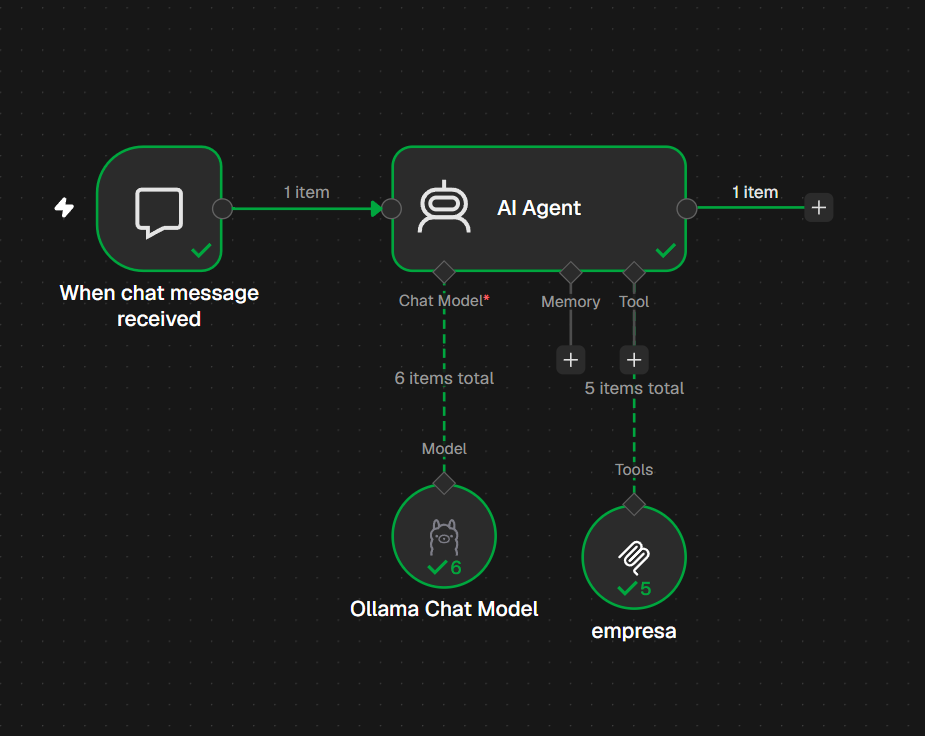

# Securing a tool-using AI agent

**Work in progress.** The lab, the threat model and a scan of the model alone are done; the attacks on the agent and the defenses come next ([status](#status)).

I'm building a local IT-support agent (n8n + gpt-oss:20b on Ollama) that uses tools served over MCP: four from the company and, in the next phase, one from a third-party vendor. The agent will be attacked with 24 prompt-injection and tool-poisoning cases, and each defense version (V0 to V4) will be measured on the same cases, together with 10 legitimate tasks that measure the cost of each defense. My [previous project](https://github.com/LuizStocco520/n8n-ai-triage-redteam) added defenses around a bot, including a model that judges whether a text is an attack. This one relies on controls that are not models (server rules, least privilege and human approval), so that they hold even when a model is fooled.

Everything runs on one PC, bound to 127.0.0.1, with invented data. No real credentials, no real e-mail.

*The V0 agent as first built and tested through n8n's chat: the AI Agent node, gpt-oss:20b on Ollama and the company's MCP tools. The measurement reaches the same agent through a webhook, added later. Prompts, tickets and code comments are in Brazilian Portuguese.*

## Status

| Phase | What | Status |
|---|---|---|
| 0 | Lab: GPU acceptance test, every service on 127.0.0.1 | done |
| 1 | Threat model, company MCP server with an audit log, V0 agent, scan of the model alone | done: the model followed instructions hidden in the data in 26% to 82% of its answers ([report](docs/model-scan.md)) |
| 2 | Vendor MCP server, the 24 attack cases, the V0 baseline | next |
| 3 | Defenses V1 to V4, each measured on the same cases | planned |
| 4 | Results, cost, limitations and the framework mapping, in this README | planned |

## Reports

| Report | What it covers |
|---|---|
| [Threat model](docs/threat-model.md) | the system, its trust boundaries, 14 threats and the control for each |
| [Model scan](docs/model-scan.md) | gpt-oss:20b alone against 20 garak probes: six findings, with every detector checked against the answers |

## Layout

| Folder | Contents |
|---|---|
| `aceitacao/` | GPU acceptance test: script and results (RX 7900 XTX, 1,738 generations in 90 minutes, zero errors) |
| `agente/` | n8n workflows, exported and cleaned (V0 to V4) |
| `docs/` | threat model, design decisions and the model scan report |
| `medicao/` | test cases, measurement scripts, the garak scan and results per version |
| `prints/` | screenshots |
| `servidores/` | MCP servers: company and third-party vendor |
| `testes/` | pytest tests for the server and the scripts |

Folders are created as the project reaches them.

## How this was built

The idea, the decisions and every run are mine. I came to this project knowing the concepts and the theory; this is where I practice them. I built the agent in n8n, ran every command, scan and measurement on my own PC, reviewed the outputs, decided what to change and committed each change. Claude, an AI assistant, was my study guide throughout: it explained each step and why it mattered, answered my questions as they came up, and drafted the code, the tests, the threat model and the reports. The numbers in the scan report were recomputed by scripts from garak's raw reports and log, and checked against the published CSV before publication.
