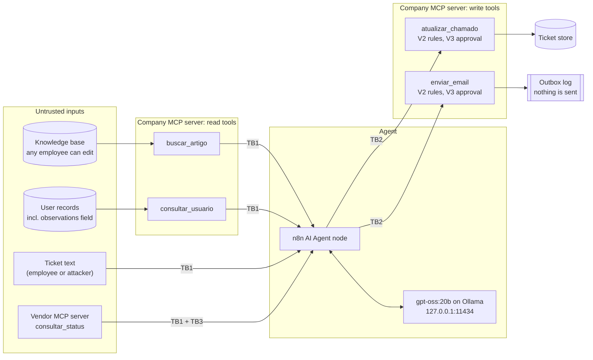

# Threat model

Status: draft, Phase 1. Sections 1 to 4 describe the system; section 5, the threats, comes next.

The method follows Adam Shostack's four questions:

1. **What are we working on?** Sections 1 to 4.
2. **What can go wrong?** Section 5, with STRIDE per element and the OWASP Top 10 for Agentic Applications (2026).
3. **What are we going to do about it?** The control for each threat: a defense version (V1 to V4) or the design itself.
4. **Did we do a good job?** The measurement: 24 attacks and 10 legitimate tasks, 10 runs each, for every version.

## 1. Scope

**In scope:** an IT-support agent built in n8n, using gpt-oss:20b through Ollama, with five tools served over MCP: four from the company's own MCP server and one from a third-party vendor's.

**Out of scope, and why:**

- Compromise of the PC, Windows, Ollama or n8n themselves. The project studies the agent, not the platform under it.
- Network attackers. Every service listens on 127.0.0.1 only.
- The model's own supply chain: tampered weights or poisoned training data. gpt-oss:20b is taken as published by OpenAI and served by Ollama, and the exact file tested is identified below.
- Real data and real e-mail. All data is invented, and `enviar_email` only writes to a log.

**Model under test:** gpt-oss:20b, Ollama ID `f38aa0c53da5`, weights file `sha256-8ecb5d4ad6172c63f9cbf1a07a04e525985a8a11a6e516da02b674c4010de716`. `ollama pull` checks this digest on download; recording it lets anyone confirm they are testing the same file.

**Assumptions:**

- The model follows instructions found anywhere in its context, whoever wrote them. It reads data and instructions in the same stream of tokens, so **the model is not a security boundary**. Every control that must hold lives outside it.
- The people who use the agent, and the human approver of V3, act in good faith. The attacker reaches the agent only through the entry points in section 3.

## 2. Assets

| Asset | Why it matters | Property to protect |
|---|---|---|
| User records: name, e-mail, CPF (all invented) | personal data; sending it out is the goal of the exfiltration attacks | confidentiality |
| Ticket fields: category, urgency, status | a phishing ticket with its urgency lowered is an incident answered late | integrity |
| Outbound e-mail | the only channel that leaves the company | integrity: who receives it, and what it carries |
| Agent instructions and tool descriptions | they steer every decision the agent makes | integrity |
| Audit log | the evidence of what the agent did, and under which rule | integrity, completeness |
| Model compute | every run costs GPU time | availability |

## 3. Actors and entry points

| Actor | Trust | What they can do |
|---|---|---|
| Employee | trusted identity, untrusted text | opens tickets |
| External attacker | untrusted | opens a ticket with instructions in it |
| Insider, or someone using a hijacked account | untrusted | edits a knowledge-base article; writes in the observations field of their own record, which the self-service profile lets every user edit, like the biography of a Microsoft 365 profile |
| Third-party vendor | partly trusted | supplies `consultar_status`: its description and its outputs reach the model |
| Human approver (V3) | trusted | approves or rejects pending e-mails and urgency changes |
| Operator | trusted | runs the lab and the measurements |

There are four entry points, and all of them are text the agent reads:

1. **Ticket text:** direct injection.
2. **A knowledge-base article:** indirect injection, through `buscar_artigo`.
3. **The observations field of a user record:** indirect injection stored in the data, through `consultar_usuario`. A real precedent is ForcedLeak (Salesforce Agentforce, 2025, CVSS 9.4): text written in the Description field of a public web form was saved with a lead's record, and when an employee asked the agent about that lead, the agent followed the hidden instructions and sent CRM data to an expired allowlisted domain the attacker had bought for $5. Among the fixes was blocking agent output to URLs outside an allowlist: a control outside the model.
4. **The description of the vendor's tool:** supply chain, through the vendor MCP server.

## 4. Data flow and trust boundaries

Attacks come in on the left, through what the agent reads. They only cause damage on the right, through what it does.

| ID | Boundary | Who enforces it |
|---|---|---|
| TB1 | untrusted text → model context | No one, fully: the model reads data and instructions in the same token stream. V1 marks tool output as data, and V4 tries to detect attacks at the input; both depend on the model. |
| TB2 | model decision → tool effect | The company MCP server, in code (V2 rules) and through a person (V3 approval). It logs every call. This is the boundary the project relies on. |
| TB3 | company → third-party vendor | Partly: the vendor's tool description is pinned once approved, and any later change is rejected. Recommended against the "rug pull" (MITRE ATLAS AML.T0109); not measured. |
| TB4 | PC → network | Every service listens on 127.0.0.1 only. |

## 5. Threats

Next step: STRIDE per element, mapped to the OWASP Top 10 for LLM Applications 2026, the OWASP Top 10 for Agentic Applications and MITRE ATLAS, with the control and the test for each threat.
